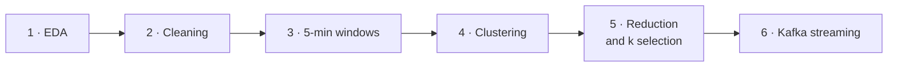

<div align="center">

# 🏠 Big Data Project  — Multi-Sensor Smart Home

**Summary report covering the six project phases**


</div>

> [!NOTE]
> This report presents the results and their interpretation. The exact commands for every phase are documented in `README.md`.

---

## 📑 Table of contents

1. [Context and research question](#1--context-and-research-question)
2. [Data](#2--data)
3. [Methodology by phase](#3--methodology-by-phase)
4. [Answer to the research question](#4--answer-to-the-research-question)
5. [Limitations](#5--limitations)
6. [Improvement ideas](#6--improvement-ideas)
7. [Reproduction](#7--reproduction)

---

## 1 · Context and research question

The *Multi-sensor Smart Home* dataset (Mendeley) contains measurements from **24 home-automation sensors** recorded in a house over **182 days**.

> [!IMPORTANT]
> **Research question:** can the behavior of the house be described by *measurement profiles*, and can these profiles be computed continuously on a data stream?

Two constraints shaped the methodological choices:

- the dataset provides **no activity labels**, which points to an **unsupervised** approach;
- the Big Data objective requires working on the **full volume** with PySpark, and showing that the trained model then runs on a **stream**.

---

## 2 · Data

| Indicator | Value |
| --- | ---: |
| Measurements read | 247,304,708 |
| Sensors declared and measured | 24 |
| Period covered | 2020-02-26 → 2020-08-26 (182.5 days) |
| Measurements per hour (average) | 56,469 |
| Missing or non-finite values | 0 |
| Corrupted records | 0 |
| Orphan measurements (unknown sensor) | 0 |
| Negative values | 6 |
| Zeros | 156,478,448 |
| Positive values | 90,826,254 |

The dataset is of **very high quality**: no missing values, no unreadable records, and no integrity break between `sensor.csv` and the measurements.

The only anomaly is the **6 negative values**, all concentrated on a washing-machine current sensor. They are physically impossible and were **flagged rather than deleted**.

---

## 3 · Methodology by phase



### Phase 1 — Ingestion and exploratory analysis

The 12.4 GB of CSV files are read with an explicit Spark schema.

- Volumes, periods and integrity checks are computed on **all** rows.
- Quantiles and time profiles are computed on a **1 % random sample** (2,471,863 rows, seed 42) to avoid saturating the driver.

> [!TIP]
> **Interpretation.** The share of zeros (63 %) is the most important finding of this phase. A zero means "sensor inactive", **not** "missing measurement". Confusing the two would have led to a destructive and wrong cleaning step. This distinction is preserved throughout the project.

### Phase 2 — Cleaning

**No row was removed.** Since the dataset is entirely valid, any filtering would have been arbitrary. The 6 impossible values are flagged with an `is_suspect_value` indicator so they are excluded from statistics without losing track of their existence.

> [!TIP]
> **Interpretation.** Cleaning does not always mean deleting. Here, the right move was **annotation**.

### Phase 3 — Time-based feature construction

Aggregation by **5-minute windows** and by sensor, then a pivot from a long table (942,862 rows) to a wide table (**50,220 windows × 224 columns**).

| Level | Features |
| --- | --- |
| Per sensor and per window | sample count, mean, min, max, standard deviation, last value, number of positive values, number of zeros |
| Context | number of active sensors, total volume, hour, day of week |

> [!TIP]
> **Interpretation.** The 5-minute window is a compromise: fine enough to tell occupancy from absence, wide enough for each sensor to produce a handful of usable measurements. Keeping `null` for a sensor absent from a window is essential, as it separates *no measurement* from *inactive measurement*.

### Phase 4 — Standardization and clustering

KMeans on the **175 variables** of the full table, with a chronological **70 % / 15 % / 15 %** split. Imputation and the standard scaler are fitted **on the training period only** to avoid data leakage.

| Result | Value |
| --- | ---: |
| Validation silhouette | **−0.2574** (negative) |

> [!WARNING]
> **Interpretation.** This is the first sign that the model does not separate future periods. KMeans applied to raw measurements mainly recovers **traffic density**, which changes over time with wear and with household evolution. The variable-reduction sequence starts here.

### Phase 5 — Reduction and model selection

Four successive steps:

1. **Stable sensor selection** — 8 of the 24 sensors cover at least 95 % of the windows. The other 16 appear only on part of the period (some start in mid-March, others exist only in summer).
2. **Variable reduction** — 175 → 47 variables, a **73.14 % reduction**, keeping 5 statistics per sensor and the 7 context variables.
3. **Reduced model training** — validation silhouette improves from −0.2574 to **−0.1450**. The improvement is real but insufficient.
4. **Robust selection of k** — a minimum cluster size criterion (1 % of windows) rules out k = 3 to 6, which all produce a micro-cluster of 0.15 %.

**Final model: k = 2, 47 variables.**

| Cluster | Windows | Share | Active sensors | Samples | Mean hour |
| :---: | ---: | ---: | ---: | ---: | ---: |
| **0** | 26,133 | 52.04 % | 20.54 | 5,322.1 | 13.26 |
| **1** | 24,087 | 47.96 % | 16.86 | 4,492.9 | 9.62 |

> [!IMPORTANT]
> **Interpretation.** The two clusters are balanced, but they differ first in the **number of active sensors** and the **volume of measurements**. A cluster therefore describes a *measurement density profile*, not an identified human activity. Naming them "presence" or "absence" would be a misinterpretation.

### Phase 6 — Kafka streaming

Full architecture:

```text
Kafka producer → Structured Streaming → per-window aggregation → KMeans model
```

The topic was fed with **three historical replays** of opposite profiles:

| Replay | Period | Messages | Profile |
| --- | --- | ---: | --- |
| Night | 2020-06-17 21:00 → 23:59 | 209,736 | 23 sensors |
| Dense day | 2020-06-18 09:00 → 11:59 | 211,084 | 23 sensors |
| Sparse day | 2020-06-29 07:00 → 09:29 | 63,272 | 9 sensors |

**Consumer result:** **484,092** JSON messages decoded and written to Parquet, i.e. the entire topic.

**Inference result:**

| Indicator | Value |
| --- | ---: |
| Messages consumed | 484,092 |
| Micro-batches | 7 |
| Windows predicted | 108 |
| Distinct windows | 102 |
| Cluster 0 | 78 (72.2 %) |
| Cluster 1 | 30 (27.8 %) |

> [!IMPORTANT]
> **Interpretation.** This is the most telling result of the project. Dense days (23 sensors, ≈ 5,800 samples per window) and sparse days (9 sensors, ≈ 1,900 samples) **do not map to the same cluster**, even though they last only a few hours. The model therefore discriminates **measurement density**, which confirms the phase 5 interpretation — and the streaming pipeline faithfully reproduces the offline behavior.

**Three defects fixed during this phase**

| Defect | Cause | Fix |
| --- | --- | --- |
| **2-hour timezone shift** | Converting timestamps to a Python `datetime` applied the machine's local timezone, shifting every window | Timestamps are now rendered by Spark SQL in the session timezone |
| **`numInputRows` overestimated ×3** | It accumulates rows re-read when tasks are re-executed | The counter is read from the Kafka offsets instead |
| **`StackOverflowError` in the query** | The `withWatermark` + `dropDuplicates` combination requires a local state store that is unstable on Windows and adds nothing to a per-micro-batch aggregation | Combination removed |

---

## 4 · Answer to the research question

The behavior of the house **can** be described by measurement profiles, and these profiles **can be computed continuously**.

However, these profiles measure **activity density**, not human activity: the dataset contains no annotation that would allow us to decide.

The clustering is therefore **exploratory**. Phase 6 demonstrates the architecture, **not** production-grade accuracy.

---

## 5 · Limitations

- 📉 **Negative validation silhouette** (−0.145): the centers learned on the training period do not properly separate future periods.
- 🏷️ **Unsupervised clustering**: it gives a measurement profile, not an activity name.
- 📏 **Heterogeneous units**: sensors use different units and are comparable only after standardization.
- 🔁 **Duplicate predictions**: inference applies the model per micro-batch, so a window straddling two micro-batches is predicted twice. A real deployment would use stateful aggregation with a watermark.
- ⏪ **Replayed stream**: the flow is a historical replay, not a stream from physical sensors in real time.
- 🎲 **Approximate quantiles**: phase 1 quantiles are estimates on 1 % of the rows, whereas volumes and integrity checks cover all 247,304,708 rows.

---

## 6 · Improvement ideas

- Add more recent data, or other households, to check whether the separation stabilizes over time.
- Build **pseudo-labels** from contact and motion sensors, then measure whether the clusters match them.
- Replace per-micro-batch aggregation with **stateful aggregation**.
- Move to a **supervised model** as soon as activity annotations are available.

---

## 7 · Reproduction

The exact commands for each phase are documented in `README.md`. Execution order:

```text
phase1_eda.py                  → outputs/eda/
phase2_cleaning.py             → data/processed/measurements_clean/
phase3_features.py             → data/processed/features_5min/
phase4_clustering.py           → models/ and outputs/phase4_clustering/
phase5_sensor_selection.py     → outputs/phase5_sensor_selection/
phase5_feature_reduction.py    → data/processed/features_5min/window_features_reduced/
phase4_clustering.py           → reduced model (47 variables, k=2)
phase5_model_selection.py      → outputs/phase5_model_selection/
phase6_kafka_producer.py       → topic smart-home-events
phase6_streaming_consumer.py   → outputs/phase6_streaming/parsed_events/
phase6_streaming_inference.py  → outputs/phase6_streaming/cluster_predictions/
```

The local Kafka broker is provided by `docker-compose.yml` (`docker compose up -d`).
