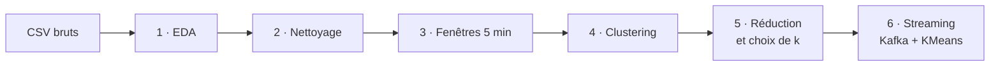

<div align="center">

# 🏠 Smart Home Big Data Analysis

**Analyse de bout en bout du dataset Mendeley *Multi-sensor dataset of human activities in a smart home environment* avec PySpark**


📄 [Rapport de synthèse](RAPPORT.md) · 🚀 [Démarrage rapide](#-démarrage-rapide) · 📊 [Résultats](#-principaux-résultats)

</div>

> [!NOTE]
> Ce README décrit la **structure du dépôt** et les **commandes d'exécution**.
> L'interprétation détaillée de chaque phase se trouve dans [`RAPPORT.md`](RAPPORT.md).

---

## 📑 Sommaire

1. [Vue d'ensemble du pipeline](#-vue-densemble-du-pipeline)
2. [Structure du dépôt](#-structure-du-dépôt)
3. [Démarrage rapide](#-démarrage-rapide)
4. [Phases 1 à 5 — Analyse et modélisation](#-phases-1-à-5--analyse-et-modélisation)
5. [Phase 6 — Streaming Kafka](#-phase-6--streaming-kafka)
6. [Principaux résultats](#-principaux-résultats)
7. [Guide de lecture des sorties](#-guide-de-lecture-des-sorties)
8. [Limites importantes](#-limites-importantes)

---

## 🧭 Vue d'ensemble du pipeline



| Phase | Script(s) | Objectif |
| :---: | --- | --- |
| **1** | `phase1_eda.py` | Ingestion, contrôles qualité, statistiques |
| **2** | `phase2_cleaning.py` | Normalisation et écriture Parquet |
| **3** | `phase3_features.py` | Agrégation en fenêtres de 5 minutes |
| **4** | `phase4_clustering.py` | Standardisation + KMeans |
| **5** | `phase5_sensor_selection.py`<br>`phase5_feature_reduction.py`<br>`phase5_model_selection.py` | Capteurs stables, réduction des variables, choix robuste de `k` |
| **6** | `phase6_kafka_producer.py`<br>`phase6_streaming_consumer.py`<br>`phase6_streaming_inference.py` | Rejeu Kafka, consommation et inférence en continu |

---

## 📁 Structure du dépôt

```text
BigData/
├── human_activity_raw_sensor_data/
│   ├── sensor.csv
│   ├── sensor_sample_int.csv
│   └── sensor_sample_float.csv
├── src/
│   ├── phase1_eda.py
│   ├── phase2_cleaning.py
│   ├── phase3_features.py
│   ├── phase4_clustering.py
│   ├── phase5_sensor_selection.py
│   ├── phase5_feature_reduction.py
│   ├── phase5_model_selection.py
│   ├── phase6_kafka_producer.py
│   ├── phase6_streaming_consumer.py
│   └── phase6_streaming_inference.py
├── outputs/
│   ├── eda/                       # phase 1
│   ├── phase2_cleaning/
│   ├── phase3_features/
│   ├── phase4_clustering/
│   ├── phase5_sensor_selection/
│   ├── phase5_feature_reduction/
│   ├── phase5_reduced_clustering/
│   ├── phase5_model_selection/
│   ├── phase5_final_model/
│   └── phase6_streaming/
├── docker-compose.yml
├── requirements.txt
├── RAPPORT.md
└── README.md
```

---

## 🚀 Démarrage rapide

### Prérequis

| Élément | Version / Besoin |
| --- | --- |
| Python | 3.10 ou plus récent |
| Java | 17 (pour Spark) |
| Mémoire | au moins 8 Go de RAM disponibles |
| Disque | **35 à 40 Go libres** (dataset, cache Spark, fichiers temporaires, résultats) |
| Docker Desktop | requis uniquement pour la [phase 6](#-phase-6--streaming-kafka) |

### Installation

```powershell
py -m venv .venv
.\.venv\Scripts\python.exe -m pip install --upgrade pip
.\.venv\Scripts\python.exe -m pip install -r requirements.txt
```

> [!TIP]
> Le script recherche automatiquement une installation Java 17+ sur Windows.
> Si aucune n'est détectée, définissez la variable d'environnement `JAVA_HOME`.

---

## 🔬 Phases 1 à 5 — Analyse et modélisation

### Phase 1 — Ingestion et EDA

Le script `src/phase1_eda.py` :

1. vérifie la présence et la taille des trois fichiers ;
2. lit les métadonnées des capteurs ;
3. lit les mesures avec des schémas Spark explicites ;
4. vérifie types, timestamps, valeurs manquantes et relations entre fichiers ;
5. calcule les statistiques globales et par capteur ;
6. crée un échantillon aléatoire de 1 % pour les quantiles et profils temporels ;
7. produit des tableaux CSV, des graphiques et `eda_report.md`.

> [!IMPORTANT]
> Les volumes et contrôles de qualité portent sur **toutes les mesures**.
> Les quantiles et profils d'activité sont calculés sur l'**échantillon**, afin de limiter les recomputations.

**Exécution complète**

```powershell
.\.venv\Scripts\python.exe src\phase1_eda.py `
  --master "local[8]" `
  --shuffle-partitions 32 `
  --sample-fraction 0.01 `
  --seed 42
```

<details>
<summary><b>Variantes : passage allégé et répertoire de travail personnalisé</b></summary>

<br>

Un second passage avec un échantillon plus petit reste une **ingestion complète** :

```powershell
.\.venv\Scripts\python.exe src\phase1_eda.py `
  --master "local[4]" `
  --shuffle-partitions 16 `
  --sample-fraction 0.002 `
  --no-write-sample-parquet `
  --output-dir outputs\eda_light
```

Le répertoire de travail Spark peut être placé sur un autre disque :

```powershell
.\.venv\Scripts\python.exe src\phase1_eda.py `
  --master "local[8]" `
  --scratch-dir "D:\spark-temp\smart-home"
```

</details>

> [!NOTE]
> Cette première version accepte uniquement un master `local[...]`, car elle lit des fichiers présents sur le poste.

<details>
<summary><b>Arborescence des sorties de la phase 1</b></summary>

```text
outputs/eda/
├── eda_report.md
├── run_manifest.json
├── dataset_inventory.json
├── tables/
│   ├── sensor_metadata.csv
│   ├── summary_by_file.csv
│   ├── overall_quality.json
│   ├── sensor_summary.csv
│   ├── orphan_sensor_events.csv
│   ├── sensors_without_measurements.csv
│   ├── value_quantiles_sample.csv
│   ├── daily_activity_sample.csv
│   ├── hourly_activity_sample.csv
│   ├── activity_by_hour_of_day.csv
│   ├── activity_by_day_of_week.csv
│   ├── sample_events_first_by_time.csv
│   └── sample_events_highest_ids.csv
└── charts/
    ├── daily_activity.png
    ├── activity_by_hour.png
    ├── top_sensors.png
    └── sensor_coverage.png
```

</details>

---

### Phase 2 — Nettoyage léger

Normalise les mesures, les associe aux capteurs et les écrit en Parquet.

```powershell
.\.venv\Scripts\python.exe src\phase2_cleaning.py --master "local[4]" --shuffle-partitions 16
```

**Sorties**

```text
data/processed/measurements_clean/
outputs/phase2_cleaning/cleaning_report.md
outputs/phase2_cleaning/cleaning_summary.json
```

**Règles de nettoyage**

- ✅ Les **zéros** sont conservés : ils représentent un état normal.
- ⚠️ Les **courants négatifs** sont conservés mais signalés par `is_suspect_value`.
- ⏭️ Le **dédoublonnage exact** est désactivé par défaut (trop coûteux sur 247 millions de lignes).

> [!WARNING]
> Sous Windows, l'écriture Parquet nécessite `winutils.exe` et `hadoop.dll`.
> Le script détecte une installation locale ; sinon, utilisez `--hadoop-home` avec un dossier contenant `bin/winutils.exe` et `bin/hadoop.dll`.

---

### Phase 3 — Construction des fenêtres temporelles

Lit le Parquet nettoyé et regroupe les événements par fenêtre de cinq minutes.

```powershell
.\.venv\Scripts\python.exe src\phase3_features.py `
  --master "local[4]" `
  --shuffle-partitions 16 `
  --window "5 minutes" `
  --scratch-dir "C:\Users\zahra\AppData\Local\Temp\opencode\phase3_spark"
```

**Sorties**

```text
data/processed/features_5min/sensor_features_long/
data/processed/features_5min/window_features_wide/
outputs/phase3_features/feature_report.md
outputs/phase3_features/feature_dictionary.csv
```

| Table | Contenu |
| --- | --- |
| `sensor_features_long` | Statistiques par capteur et par fenêtre |
| `window_features_wide` | Une ligne par fenêtre, colonnes prêtes pour Spark ML |

> [!NOTE]
> Les valeurs marquées `is_suspect_value` sont exclues des statistiques, mais leur nombre est conservé.

---

### Phase 4 — Standardisation et clustering

Sépare les fenêtres par **ordre chronologique**, ajuste l'imputation et le `StandardScaler` **uniquement sur la période d'entraînement**, puis recherche le meilleur nombre de clusters.

```powershell
.\.venv\Scripts\python.exe src\phase4_clustering.py `
  --master "local[4]" `
  --shuffle-partitions 16 `
  --k-candidates "2,3,4,5,6" `
  --scratch-dir "C:\Users\zahra\AppData\Local\Temp\opencode\phase4_spark"
```

**Sorties**

```text
models/phase4_kmeans/preprocessing/
models/phase4_kmeans/kmeans/
data/processed/clustering_5min/
outputs/phase4_clustering/clustering_report.md
outputs/phase4_clustering/cluster_profiles.csv
outputs/phase4_clustering/k_selection.csv
```

> [!IMPORTANT]
> Le clustering est **non supervisé** : les clusters doivent être interprétés avec `feature_dictionary.csv` et ne constituent pas automatiquement des noms d'activités.

---

### Phase 5 — Réduction et sélection du modèle

#### Étape 1 · Sélection des capteurs stables

Conserve les capteurs présents dans au moins **95 %** des fenêtres observées (lit la table longue de la phase 3).

```powershell
.\.venv\Scripts\python.exe src\phase5_sensor_selection.py `
  --master "local[4]" `
  --shuffle-partitions 16 `
  --min-window-coverage 0.95 `
  --scratch-dir "C:\Users\zahra\AppData\Local\Temp\opencode\phase5_sensor"
```

```text
outputs/phase5_sensor_selection/stable_sensor_selection.csv
outputs/phase5_sensor_selection/stable_sensor_names.txt
outputs/phase5_sensor_selection/sensor_selection_summary.json
outputs/phase5_sensor_selection/sensor_selection_report.md
```

Cette étape ne modifie pas encore le modèle de clustering : elle prépare uniquement la liste des capteurs stables.

#### Étape 2 · Réduction des variables

Utilise les **8 capteurs stables** et conserve **5 statistiques par capteur**.

```powershell
.\.venv\Scripts\python.exe src\phase5_feature_reduction.py `
  --master "local[4]" `
  --shuffle-partitions 16 `
  --scratch-dir "C:\Users\zahra\AppData\Local\Temp\opencode\phase5_reduction"
```

```text
data/processed/features_5min/window_features_reduced/
outputs/phase5_feature_reduction/feature_reduction_report.md
outputs/phase5_feature_reduction/reduced_feature_dictionary.csv
outputs/phase5_feature_reduction/feature_reduction_summary.json
```

Le clustering n'est pas encore réentraîné à cette étape.

#### Étape 3 · Sélection robuste de `k`

Entraîne KMeans sur toute la période d'entraînement pour plusieurs valeurs de `k`, mesure les silhouettes **entraînement / validation / test** et impose une taille minimale de cluster.

```powershell
.\.venv\Scripts\python.exe src\phase5_model_selection.py `
  --master "local[4]" `
  --shuffle-partitions 16 `
  --k-candidates "2,3,4,5,6" `
  --min-cluster-share 0.01 `
  --evaluation-sample-fraction 0.30 `
  --scratch-dir "C:\Users\zahra\AppData\Local\Temp\opencode\phase5_model_selection"
```

```text
outputs/phase5_model_selection/k_selection_full.csv
outputs/phase5_model_selection/model_selection_summary.json
outputs/phase5_model_selection/model_selection_report.md
outputs/phase5_model_selection/charts/
```

---

## 📡 Phase 6 — Streaming Kafka

> [!NOTE]
> Il s'agit d'un **rejeu contrôlé** du dataset historique, et non de capteurs physiques temps réel.

### 6.1 · Infrastructure

Docker Desktop doit être démarré. Le broker Kafka local est défini dans `docker-compose.yml`.

```powershell
docker compose up -d
```

Création du topic :

```powershell
docker exec smart-home-kafka /opt/kafka/bin/kafka-topics.sh `
  --bootstrap-server localhost:9092 `
  --create --if-not-exists `
  --topic smart-home-events `
  --partitions 1 `
  --replication-factor 1
```

Vérification :

```powershell
docker exec smart-home-kafka /opt/kafka/bin/kafka-topics.sh `
  --bootstrap-server localhost:9092 `
  --list
```

### 6.2 · Producteur

Relit les mesures nettoyées sur une tranche de temps donnée et envoie des messages JSON dans `smart-home-events`, par ordre chronologique.

```powershell
.\.venv\Scripts\python.exe src\phase6_kafka_producer.py `
  --bootstrap-server "localhost:9092" `
  --topic "smart-home-events" `
  --start "2020-06-18 09:00:00" `
  --end "2020-06-18 12:00:00" `
  --max-rows 250000 `
  --delay-seconds 0
```

Les envois sont asynchrones (`acks=all`) ; les acquittements en erreur sont comptés puis signalés.

### 6.3 · Consommateur Spark Structured Streaming

Lit le topic, valide les messages JSON et les sauvegarde en Parquet.

```powershell
.\.venv\Scripts\python.exe src\phase6_streaming_consumer.py `
  --bootstrap-server "localhost:9092" `
  --topic "smart-home-events" `
  --timeout-seconds 1500 `
  --max-offsets-per-trigger 80000
```

```text
outputs/phase6_streaming/parsed_events/       # non versionné, régénérable
outputs/phase6_streaming/consumer_summary.json
```

> [!TIP]
> La première exécution peut télécharger le connecteur `spark-sql-kafka-0-10_2.13:4.2.0` via Maven/Ivy.

> [!NOTE]
> Les événements sont écrits en Parquet au fil des micro-batchs. Un sink mémoire avait été essayé en premier : il conserve tout le topic en RAM et déclenche un `OutOfMemoryError` dès que le topic dépasse quelques centaines de milliers de messages.

### 6.4 · Inférence KMeans

Regroupe chaque micro-batch par fenêtre de cinq minutes, reconstruit les **47 variables** du modèle final (8 capteurs × 5 statistiques + 7 variables de contexte) et prédit le cluster.

```powershell
.\.venv\Scripts\python.exe src\phase6_streaming_inference.py `
  --bootstrap-server "localhost:9092" `
  --topic "smart-home-events" `
  --timeout-seconds 900 `
  --max-offsets-per-trigger 70000
```

- La query s'arrête dès qu'un micro-batch vide confirme que le topic est épuisé.
- Le checkpoint et le répertoire de prédictions sont supprimés à chaque exécution pour rejouer le flux depuis le début.
- Les capteurs absents d'une fenêtre restent nuls et sont imputés par le modèle de preprocessing, exactement comme à l'entraînement. C'est indispensable : `active_sensor_count` et `total_sample_count` n'ont de sens que si le flux contient tous les capteurs.

### 6.5 · Résultats du rejeu

Le topic a été alimenté par trois rejeux (17, 18 et 29 juin 2020), couvrant des profils opposés :

| Période | Messages | Profil |
| --- | ---: | --- |
| 2020-06-17 21:00 → 23:59 | 209 736 | Nuit |
| 2020-06-18 09:00 → 11:59 | 211 084 | Journée dense (23 capteurs) |
| 2020-06-29 07:00 → 09:29 | 63 272 | Journée creuse (9 capteurs) |

**Inférence**

| Indicateur | Valeur |
| --- | ---: |
| Messages consommés | **484 092** |
| Micro-batchs | **7** |
| Fenêtres prédites | **108** (dont **102** distinctes) |
| Cluster 0 | **78** fenêtres (72,2 %) |
| Cluster 1 | **30** fenêtres (27,8 %) |

Les journées denses et creuses ne se rattachent pas au même cluster : la séparation apprise porte d'abord sur la **densité des mesures**, et non sur une activité humaine identifiée.

> [!WARNING]
> **Deux points de vigilance** (détaillés dans le rapport) :
> - Une fenêtre à cheval sur deux micro-batchs est prédite deux fois (108 prédictions pour 102 fenêtres). Un déploiement réel utiliserait une agrégation avec état et une marque temporelle (*watermark*).
> - Les horodatages sont rendus par Spark SQL en **UTC** : passer par un `datetime` Python introduirait un décalage de fuseau et décalerait toutes les fenêtres.

---

## 📊 Principaux résultats

### Vue d'ensemble

| Phase | Résultat clé |
| :---: | --- |
| **1 — EDA** | 247 304 708 mesures, 24 capteurs, 182,5 jours, **0** valeur manquante, **0** enregistrement corrompu |
| **2 — Nettoyage** | **0** ligne supprimée, 6 valeurs impossibles signalées (`is_suspect_value`) |
| **3 — Fenêtres** | 50 220 fenêtres de 5 min, table large de 224 colonnes |
| **4 — Clustering** | 175 variables, silhouette de validation **−0,2574** |
| **5 — Modèle final** | 175 → **47** variables (−73,14 %), **k = 2**, silhouette de validation **−0,1450** |
| **6 — Streaming** | 484 092 messages, 7 micro-batchs, 102 fenêtres prédites |

### Profils des deux clusters

| Cluster | Fenêtres | Part | Capteurs actifs | Échantillons | Heure moyenne |
| :---: | ---: | ---: | ---: | ---: | ---: |
| **0** | 26 133 | 52,04 % | 20,54 | 5 322,1 | 13,26 |
| **1** | 24 087 | 47,96 % | 16,86 | 4 492,9 | 9,62 |

> [!IMPORTANT]
> La différence principale porte sur le **nombre de capteurs actifs** et le **volume de mesures**, pas sur une activité humaine identifiée. Un cluster décrit donc un **profil de densité de mesures**.

La synthèse complète, avec l'interprétation de chaque phase, se trouve dans [`RAPPORT.md`](RAPPORT.md).

---

## 📖 Guide de lecture des sorties

| Champ / fichier | Signification |
| --- | --- |
| `row_count` | Nombre total de mesures lues par Spark |
| `valid_timestamp_rate` | Proportion de timestamps exploitables |
| `missing_or_non_finite_value_count` | Valeurs nulles, `NaN` ou infinies |
| `sensor_summary.csv` | Volume, période, moyenne, minimum et maximum par capteur. `observation_span_ratio` est un rapport de période observée, pas un véritable taux de couverture temporelle |
| `orphan_sensor_events.csv` | Mesures dont le `sensor_id` n'existe pas dans `sensor.csv` |
| `sensors_without_measurements.csv` | Capteurs déclarés mais sans aucune mesure |
| `value_quantiles_sample.csv` | Distribution approximative des valeurs, séparée par capteur |
| `activity_by_hour_of_day.csv` | Nombre de mesures selon l'heure |
| `activity_by_day_of_week.csv` | Nombre de mesures selon le jour de semaine |

---

## ⚠️ Limites importantes

- **Activité de capteur ≠ activité humaine** : certains capteurs changent d'état très souvent.
- **Unités hétérogènes** : les capteurs utilisent des unités différentes ; ne pas les comparer directement avant standardisation.
- **Pas de colonne `activity`** : une classification supervisée nécessite des annotations ou des pseudo-étiquettes validées.
- **Quantiles approximatifs** : calculés sur un échantillon de 1 %, alors que volumes et contrôles d'intégrité portent sur toutes les lignes.
- **`approx_count_distinct`** fournit seulement une estimation HLL du nombre de `value_id` distincts ; son écart avec le nombre de lignes ne prouve pas l'existence de doublons.
