<div align="center">



<br>


**End-to-end analysis of the Mendeley dataset**
*Multi-sensor dataset of human activities in a smart home environment*, built with PySpark.

[📄 Report](REPORT.md) &nbsp;•&nbsp; [🚀 Quick start](#-quick-start) &nbsp;•&nbsp; [📡 Streaming](#-phase-6--kafka-streaming) &nbsp;•&nbsp; [📊 Results](#-key-results)

</div>

<br>

> [!NOTE]
> This README covers the **repository structure** and the **execution commands**.
> The detailed interpretation of each phase is in [`REPORT.md`](RAPPORT.md).

---

## 📑 Contents

1. [Pipeline overview](#-pipeline-overview)
2. [Repository structure](#-repository-structure)
3. [Quick start](#-quick-start)
4. [Phases 1 to 5 — Analysis and modeling](#-phases-1-to-5--analysis-and-modeling)
5. [Phase 6 — Kafka streaming](#-phase-6--kafka-streaming)
6. [Key results](#-key-results)
7. [Output reading guide](#-output-reading-guide)
8. [Important limitations](#-important-limitations)

---

## 🧭 Pipeline overview

<div align="center">
  
</div>

<br>

| Phase | Script(s) | Goal |
| :---: | --- | --- |
| **1** | `phase1_eda.py` | Ingestion, quality checks, statistics |
| **2** | `phase2_cleaning.py` | Normalization and Parquet output |
| **3** | `phase3_features.py` | Aggregation into 5-minute windows |
| **4** | `phase4_clustering.py` | Standardization + KMeans |
| **5** | `phase5_sensor_selection.py`<br>`phase5_feature_reduction.py`<br>`phase5_model_selection.py` | Stable sensors, variable reduction, robust choice of `k` |
| **6** | `phase6_kafka_producer.py`<br>`phase6_streaming_consumer.py`<br>`phase6_streaming_inference.py` | Kafka replay, consumption and continuous inference |

---

## 📁 Repository structure

```text
BigData/
├── assets/
│   ├── banner.svg
│   └── pipeline.svg
├── human_activity_raw_sensor_data/
│   ├── sensor.csv
│   ├── sensor_sample_int.csv
│   └── sensor_sample_float.csv
├── src/
│   ├── phase1_eda.py
│   ├── phase2_cleaning.py
│   ├── phase3_features.py
│   ├── phase4_clustering.py
│   ├── phase5_sensor_selection.py
│   ├── phase5_feature_reduction.py
│   ├── phase5_model_selection.py
│   ├── phase6_kafka_producer.py
│   ├── phase6_streaming_consumer.py
│   └── phase6_streaming_inference.py
├── outputs/
│   ├── eda/                       # phase 1
│   ├── phase2_cleaning/
│   ├── phase3_features/
│   ├── phase4_clustering/
│   ├── phase5_sensor_selection/
│   ├── phase5_feature_reduction/
│   ├── phase5_reduced_clustering/
│   ├── phase5_model_selection/
│   ├── phase5_final_model/
│   └── phase6_streaming/
├── docker-compose.yml
├── requirements.txt
├── REPORT.md
└── README.md
```

---

## 🚀 Quick start

### Requirements

| Item | Version / Need |
| --- | --- |
| Python | 3.10 or newer |
| Java | 17 (for Spark) |
| Memory | at least 8 GB of available RAM |
| Disk | **35 to 40 GB free** (dataset, Spark cache, temporary files, results) |
| Docker Desktop | only required for [phase 6](#-phase-6--kafka-streaming) |

### Installation

```powershell
py -m venv .venv
.\.venv\Scripts\python.exe -m pip install --upgrade pip
.\.venv\Scripts\python.exe -m pip install -r requirements.txt
```

> [!TIP]
> The script automatically looks for a Java 17+ installation on Windows.
> If none is found, set the `JAVA_HOME` environment variable.

---

## 🔬 Phases 1 to 5 — Analysis and modeling

### Phase 1 — Ingestion and EDA

The `src/phase1_eda.py` script:

1. checks that the three files exist and reads their size;
2. reads the sensor metadata;
3. reads the measurements with explicit Spark schemas;
4. checks types, timestamps, missing values and relationships between files;
5. computes global and per-sensor statistics;
6. builds a 1 % random sample for quantiles and time profiles;
7. produces CSV tables, charts and `eda_report.md`.

> [!IMPORTANT]
> Volumes and quality checks cover **all measurements**.
> Quantiles and activity profiles are computed on the **sample** to limit recomputation.

**Full run**

```powershell
.\.venv\Scripts\python.exe src\phase1_eda.py `
  --master "local[8]" `
  --shuffle-partitions 32 `
  --sample-fraction 0.01 `
  --seed 42
```

<details>
<summary><b>Variants: lighter pass and custom working directory</b></summary>

<br>

A second pass with a smaller sample is still a **complete ingestion**:

```powershell
.\.venv\Scripts\python.exe src\phase1_eda.py `
  --master "local[4]" `
  --shuffle-partitions 16 `
  --sample-fraction 0.002 `
  --no-write-sample-parquet `
  --output-dir outputs\eda_light
```

The Spark working directory can be placed on another drive:

```powershell
.\.venv\Scripts\python.exe src\phase1_eda.py `
  --master "local[8]" `
  --scratch-dir "D:\spark-temp\smart-home"
```

</details>

> [!NOTE]
> This first version only accepts a `local[...]` master, because it reads files stored on the workstation.

<details>
<summary><b>Phase 1 output tree</b></summary>

```text
outputs/eda/
├── eda_report.md
├── run_manifest.json
├── dataset_inventory.json
├── tables/
│   ├── sensor_metadata.csv
│   ├── summary_by_file.csv
│   ├── overall_quality.json
│   ├── sensor_summary.csv
│   ├── orphan_sensor_events.csv
│   ├── sensors_without_measurements.csv
│   ├── value_quantiles_sample.csv
│   ├── daily_activity_sample.csv
│   ├── hourly_activity_sample.csv
│   ├── activity_by_hour_of_day.csv
│   ├── activity_by_day_of_week.csv
│   ├── sample_events_first_by_time.csv
│   └── sample_events_highest_ids.csv
└── charts/
    ├── daily_activity.png
    ├── activity_by_hour.png
    ├── top_sensors.png
    └── sensor_coverage.png
```

</details>

---

### Phase 2 — Light cleaning

Normalizes the measurements, joins them with the sensors and writes them as Parquet.

```powershell
.\.venv\Scripts\python.exe src\phase2_cleaning.py --master "local[4]" --shuffle-partitions 16
```

**Outputs**

```text
data/processed/measurements_clean/
outputs/phase2_cleaning/cleaning_report.md
outputs/phase2_cleaning/cleaning_summary.json
```

**Cleaning rules**

- ✅ **Zeros** are kept: they represent a normal state.
- ⚠️ **Negative currents** are kept but flagged with `is_suspect_value`.
- ⏭️ **Exact deduplication** is disabled by default (too costly on 247 million rows).

> [!WARNING]
> On Windows, writing Parquet requires `winutils.exe` and `hadoop.dll`.
> The script detects a local installation; otherwise use `--hadoop-home` with a folder containing `bin/winutils.exe` and `bin/hadoop.dll`.

---

### Phase 3 — Building time windows

Reads the cleaned Parquet and groups events into five-minute windows.

```powershell
.\.venv\Scripts\python.exe src\phase3_features.py `
  --master "local[4]" `
  --shuffle-partitions 16 `
  --window "5 minutes" `
  --scratch-dir "C:\Users\zahra\AppData\Local\Temp\opencode\phase3_spark"
```

**Outputs**

```text
data/processed/features_5min/sensor_features_long/
data/processed/features_5min/window_features_wide/
outputs/phase3_features/feature_report.md
outputs/phase3_features/feature_dictionary.csv
```

| Table | Content |
| --- | --- |
| `sensor_features_long` | Statistics per sensor and per window |
| `window_features_wide` | One row per window, columns ready for Spark ML |

> [!NOTE]
> Values flagged `is_suspect_value` are excluded from the statistics, but their count is kept.

---

### Phase 4 — Standardization and clustering

Splits the windows in **chronological order**, fits imputation and the `StandardScaler` **on the training period only**, then searches for the best number of clusters.

```powershell
.\.venv\Scripts\python.exe src\phase4_clustering.py `
  --master "local[4]" `
  --shuffle-partitions 16 `
  --k-candidates "2,3,4,5,6" `
  --scratch-dir "C:\Users\zahra\AppData\Local\Temp\opencode\phase4_spark"
```

**Outputs**

```text
models/phase4_kmeans/preprocessing/
models/phase4_kmeans/kmeans/
data/processed/clustering_5min/
outputs/phase4_clustering/clustering_report.md
outputs/phase4_clustering/cluster_profiles.csv
outputs/phase4_clustering/k_selection.csv
```

> [!IMPORTANT]
> The clustering is **unsupervised**: clusters must be interpreted with `feature_dictionary.csv` and are not automatically activity names.

---

### Phase 5 — Reduction and model selection

#### Step 1 · Stable sensor selection

Keeps the sensors present in at least **95 %** of the observed windows (reads the long table from phase 3).

```powershell
.\.venv\Scripts\python.exe src\phase5_sensor_selection.py `
  --master "local[4]" `
  --shuffle-partitions 16 `
  --min-window-coverage 0.95 `
  --scratch-dir "C:\Users\zahra\AppData\Local\Temp\opencode\phase5_sensor"
```

```text
outputs/phase5_sensor_selection/stable_sensor_selection.csv
outputs/phase5_sensor_selection/stable_sensor_names.txt
outputs/phase5_sensor_selection/sensor_selection_summary.json
outputs/phase5_sensor_selection/sensor_selection_report.md
```

This step does not change the clustering model yet: it only prepares the list of stable sensors.

#### Step 2 · Variable reduction

Uses the **8 stable sensors** and keeps **5 statistics per sensor**.

```powershell
.\.venv\Scripts\python.exe src\phase5_feature_reduction.py `
  --master "local[4]" `
  --shuffle-partitions 16 `
  --scratch-dir "C:\Users\zahra\AppData\Local\Temp\opencode\phase5_reduction"
```

```text
data/processed/features_5min/window_features_reduced/
outputs/phase5_feature_reduction/feature_reduction_report.md
outputs/phase5_feature_reduction/reduced_feature_dictionary.csv
outputs/phase5_feature_reduction/feature_reduction_summary.json
```

The clustering is not retrained at this step.

#### Step 3 · Robust selection of `k`

Trains KMeans on the whole training period for several values of `k`, measures **training / validation / test** silhouettes and enforces a minimum cluster size.

```powershell
.\.venv\Scripts\python.exe src\phase5_model_selection.py `
  --master "local[4]" `
  --shuffle-partitions 16 `
  --k-candidates "2,3,4,5,6" `
  --min-cluster-share 0.01 `
  --evaluation-sample-fraction 0.30 `
  --scratch-dir "C:\Users\zahra\AppData\Local\Temp\opencode\phase5_model_selection"
```

```text
outputs/phase5_model_selection/k_selection_full.csv
outputs/phase5_model_selection/model_selection_summary.json
outputs/phase5_model_selection/model_selection_report.md
outputs/phase5_model_selection/charts/
```

---

## 📡 Phase 6 — Kafka streaming

> [!NOTE]
> This is a **controlled replay** of the historical dataset, not live physical sensors.

### 6.1 · Infrastructure

Docker Desktop must be running. The local Kafka broker is defined in `docker-compose.yml`.

```powershell
docker compose up -d
```

Create the topic:

```powershell
docker exec smart-home-kafka /opt/kafka/bin/kafka-topics.sh `
  --bootstrap-server localhost:9092 `
  --create --if-not-exists `
  --topic smart-home-events `
  --partitions 1 `
  --replication-factor 1
```

Check:

```powershell
docker exec smart-home-kafka /opt/kafka/bin/kafka-topics.sh `
  --bootstrap-server localhost:9092 `
  --list
```

### 6.2 · Producer

Re-reads the cleaned measurements over a given time slice and sends JSON messages to `smart-home-events` in chronological order.

```powershell
.\.venv\Scripts\python.exe src\phase6_kafka_producer.py `
  --bootstrap-server "localhost:9092" `
  --topic "smart-home-events" `
  --start "2020-06-18 09:00:00" `
  --end "2020-06-18 12:00:00" `
  --max-rows 250000 `
  --delay-seconds 0
```

Sends are asynchronous (`acks=all`); failed acknowledgements are counted, then reported.

### 6.3 · Spark Structured Streaming consumer

Reads the topic, validates the JSON messages and saves them as Parquet.

```powershell
.\.venv\Scripts\python.exe src\phase6_streaming_consumer.py `
  --bootstrap-server "localhost:9092" `
  --topic "smart-home-events" `
  --timeout-seconds 1500 `
  --max-offsets-per-trigger 80000
```

```text
outputs/phase6_streaming/parsed_events/       # not versioned, regenerable
outputs/phase6_streaming/consumer_summary.json
```

> [!TIP]
> The first run may download the `spark-sql-kafka-0-10_2.13:4.2.0` connector through Maven/Ivy.

> [!NOTE]
> Events are written to Parquet as micro-batches complete. A memory sink was tried first: it keeps the whole topic in RAM and triggers an `OutOfMemoryError` as soon as the topic exceeds a few hundred thousand messages.

### 6.4 · KMeans inference

Groups each micro-batch into five-minute windows, rebuilds the **47 variables** of the final model (8 sensors × 5 statistics + 7 context variables) and predicts the cluster.

```powershell
.\.venv\Scripts\python.exe src\phase6_streaming_inference.py `
  --bootstrap-server "localhost:9092" `
  --topic "smart-home-events" `
  --timeout-seconds 900 `
  --max-offsets-per-trigger 70000
```

- The query stops as soon as an empty micro-batch confirms the topic is exhausted.
- The checkpoint and the predictions directory are deleted on every run so the stream is replayed from the beginning.
- Sensors missing from a window stay null and are imputed by the preprocessing model, exactly as during training. This is essential: `active_sensor_count` and `total_sample_count` only make sense if the stream contains all sensors.

### 6.5 · Replay results

The topic was fed with three replays (June 17, 18 and 29, 2020) covering opposite profiles:

| Period | Messages | Profile |
| --- | ---: | --- |
| 2020-06-17 21:00 → 23:59 | 209,736 | Night |
| 2020-06-18 09:00 → 11:59 | 211,084 | Dense day (23 sensors) |
| 2020-06-29 07:00 → 09:29 | 63,272 | Sparse day (9 sensors) |

**Inference**

| Indicator | Value |
| --- | ---: |
| Messages consumed | **484,092** |
| Micro-batches | **7** |
| Windows predicted | **108** (**102** distinct) |
| Cluster 0 | **78** windows (72.2 %) |
| Cluster 1 | **30** windows (27.8 %) |

Dense and sparse days do not map to the same cluster: the learned separation is first about **measurement density**, not an identified human activity.

> [!WARNING]
> **Two points of caution** (detailed in the report):
> - A window straddling two micro-batches is predicted twice (108 predictions for 102 windows). A real deployment would use stateful aggregation with a watermark.
> - Timestamps are rendered by Spark SQL in **UTC**: going through a Python `datetime` would introduce a timezone shift and move every window.

---

## 📊 Key results

### Overview

| Phase | Key result |
| :---: | --- |
| **1 — EDA** | 247,304,708 measurements, 24 sensors, 182.5 days, **0** missing values, **0** corrupted records |
| **2 — Cleaning** | **0** rows removed, 6 impossible values flagged (`is_suspect_value`) |
| **3 — Windows** | 50,220 five-minute windows, wide table of 224 columns |
| **4 — Clustering** | 175 variables, validation silhouette **−0.2574** |
| **5 — Final model** | 175 → **47** variables (−73.14 %), **k = 2**, validation silhouette **−0.1450** |
| **6 — Streaming** | 484,092 messages, 7 micro-batches, 102 windows predicted |

### Profiles of the two clusters

| Cluster | Windows | Share | Active sensors | Samples | Mean hour |
| :---: | ---: | ---: | ---: | ---: | ---: |
| **0** | 26,133 | 52.04 % | 20.54 | 5,322.1 | 13.26 |
| **1** | 24,087 | 47.96 % | 16.86 | 4,492.9 | 9.62 |

> [!IMPORTANT]
> The main difference is the **number of active sensors** and the **measurement volume**, not an identified human activity. A cluster therefore describes a **measurement density profile**.

The full summary, with the interpretation of each phase, is in [`REPORT.md`](REPORT.md).

---

## 📖 Output reading guide

| Field / file | Meaning |
| --- | --- |
| `row_count` | Total number of measurements read by Spark |
| `valid_timestamp_rate` | Share of usable timestamps |
| `missing_or_non_finite_value_count` | Null, `NaN` or infinite values |
| `sensor_summary.csv` | Volume, period, mean, minimum and maximum per sensor. `observation_span_ratio` is a ratio of observed period, not a true temporal coverage rate |
| `orphan_sensor_events.csv` | Measurements whose `sensor_id` does not exist in `sensor.csv` |
| `sensors_without_measurements.csv` | Sensors declared but without any measurement |
| `value_quantiles_sample.csv` | Approximate distribution of values, per sensor |
| `activity_by_hour_of_day.csv` | Number of measurements by hour |
| `activity_by_day_of_week.csv` | Number of measurements by day of week |

---

## ⚠️ Important limitations

- **Sensor activity ≠ human activity**: some sensors change state very often.
- **Heterogeneous units**: sensors use different units; do not compare them directly before standardization.
- **No `activity` column**: supervised classification needs annotations or validated pseudo-labels.
- **Approximate quantiles**: computed on a 1 % sample, while volumes and integrity checks cover every row.
- **`approx_count_distinct`** only gives an HLL estimate of the number of distinct `value_id`; a gap with the row count does not prove the existence of duplicates.

<br>

<div align="center">
  <sub>Smart Home Big Data Analysis — PySpark, Kafka, KMeans</sub>
</div>
